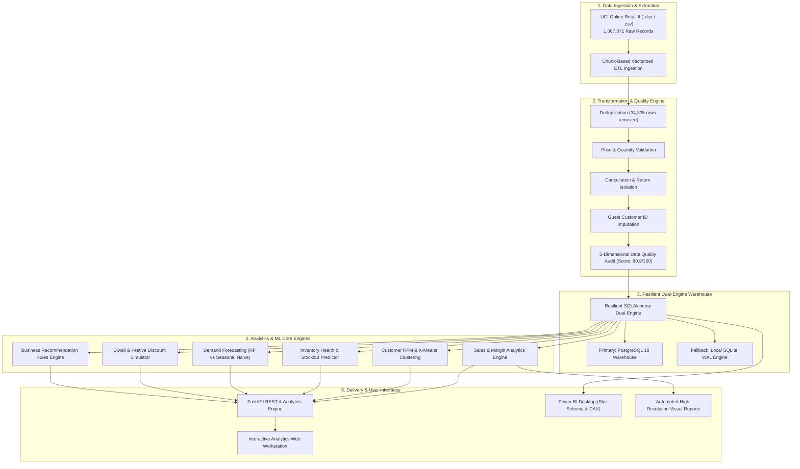
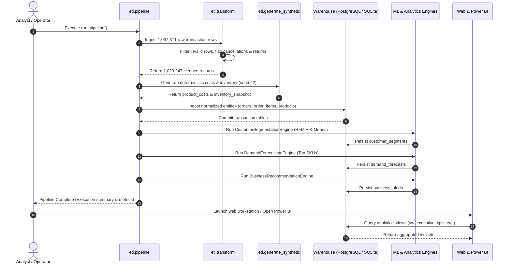
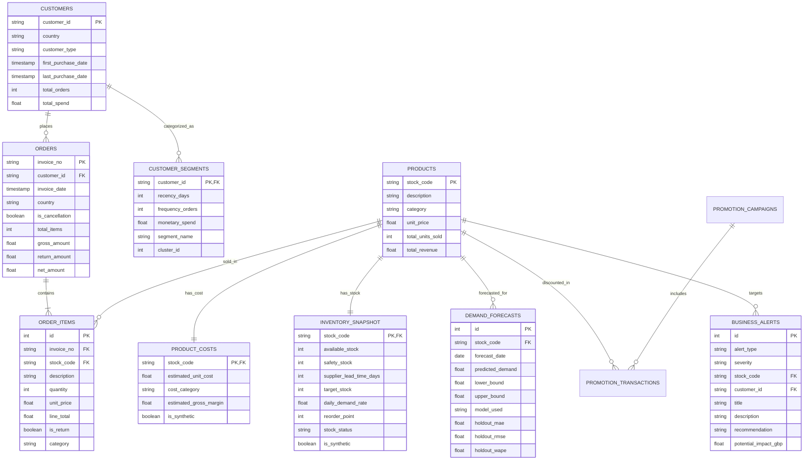

# CARTIVANTA — System Architecture & Data Model

> **Enterprise Data Platform Architecture for High-Volume Retail Analytics**

---

## 1. High-Level System Architecture

---

## 2. Pipeline Execution Sequence

---

## 3. Relational Schema & Entity-Relationship Model

---

## 4. Analytical Views Layer

CARTIVANTA exposes 11 optimized database views to decouple analytics consumption from raw transactional schemas:

1. `vw_executive_kpis`: Reconciled high-level scorecards (Gross Sales, Net Revenue, COGS, Profit, Margins, AOV).
2. `vw_monthly_sales`: Aggregated monthly time-series of gross revenue, net revenue, returns, and order volumes.
3. `vw_product_performance`: Product ranking by volume, revenue, estimated margin, and return frequency.
4. `vw_customer_rfm`: Joined customer master with calculated RFM percentiles and K-Means segment labels.
5. `vw_inventory_health`: Combined stock on hand, daily velocity, reorder thresholds, and risk classifications.
6. `vw_profitability`: Category and product-level gross profit margin rankings and loss-leader detection.
7. `vw_forecast_results`: Machine learning demand forecasts merged with product metadata.
8. `vw_festival_performance`: Historical transaction trends intersecting with festival windows.
9. `vw_promotion_performance`: Marketing campaign discount depth, unit lift, and net ROI.
10. `vw_business_recommendations`: Filtered actionable recommendations sorted by potential financial impact.
11. `vw_data_quality`: Latest ETL data quality audit dimensions and scores.

---

## 5. Technology Stack Specifications

| Layer | Component | Version / Library | Purpose |
| :--- | :--- | :--- | :--- |
| **Runtime** | Python | 3.12 | Core execution environment |
| **Data Processing** | Pandas / NumPy | 3.1.1 / 2.5.4 | High-performance vectorized transformation & cleaning |
| **Relational ORM** | SQLAlchemy | 2.1.8 | Database abstraction layer with session pooling |
| **Primary Warehouse** | PostgreSQL | 18 | Production relational database engine |
| **Embedded Engine** | SQLite (WAL mode) | 3.x | Zero-configuration local database fallback |
| **Machine Learning** | Scikit-learn / SciPy | 1.9.1 / 1.18.1 | K-Means clustering, StandardScaler, RandomForestRegressor |
| **Web Server** | FastAPI / Uvicorn | 0.162.2 / 0.54.0 | High-performance asynchronous API & web interface |
| **Front-End Styling** | Tailwind CSS / ApexCharts | CDN | Editorial dashboard visualization workstation |
| **Reporting** | Power BI Desktop | Latest | Business intelligence semantic model, star schema, DAX |
| **Visualizer** | Matplotlib / Seaborn | 3.11.2 / 0.13.2 | Automated high-resolution report artifact generation |
| **Testing** | Pytest / Pytest-Cov | 9.2.0 / 7.1.0 | Unit, integration, and mathematical reconciliation tests |
